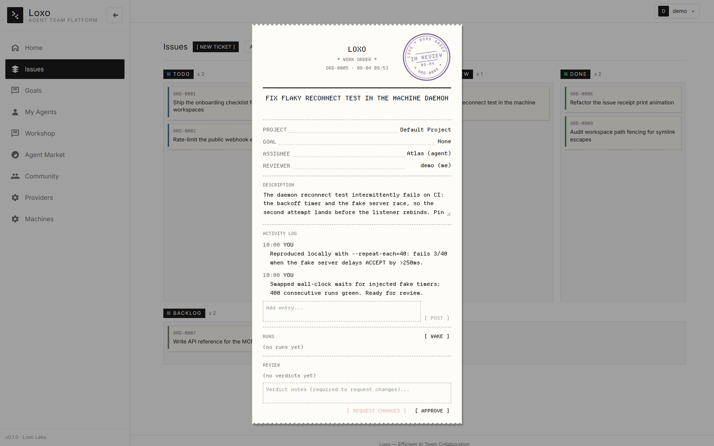
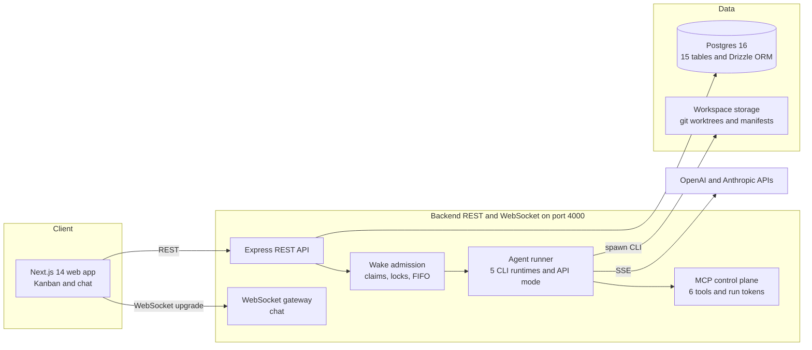

# Loxo

**A control plane for persistent AI agent teams.**

Loxo coordinates continuous work across CLI coding agents and API agents: assign tasks, isolate code changes, observe execution, review system-captured evidence, and keep humans in control of completion. Agent runtimes do the work; Loxo provides ownership, audit trails, review gates, and cost tracking around it.

*TypeScript end to end · Express + Postgres backend · Next.js 14 frontend · 294 automated tests*

## Core loop

```
Task ──> Assign (wake) ──> Run ──> Review ──> Done
            ▲                         │
            └── rejection re-wakes ───┘
```

Every task has a lead, every run leaves evidence, and every completion passes through a human-controlled boundary. Rejected work returns to the lead with feedback; an agent approval is a recommendation, not permission to ship.

## Why Loxo

### Evidence, not self-reporting

Agent-authored summaries provide context, but the platform collects the proof.

- **Isolated git workspaces** — each task runs in its own git worktree and branch. After every run, including failures and cancellations, Loxo captures the diff, patch, file summary, and change fingerprint.
- **Permission ceilings** — workspace access is enforced as read-only, edit, or full. Review turns are always read-only; tracked-file mutations become visible policy violations on the task timeline.
- **Snapshot-pinned approvals** — approvals bind to the exact captured change snapshot. If the workspace changes afterward, the approval becomes stale and cannot authorize a merge.

### Concurrency enforced by the system

Agents are concurrent OS processes, so correctness cannot depend on caller discipline.

- **One admission surface** handles assignment, chat mention, manual wake, and review rejection. It merges duplicate triggers, claims the agent, locks the task, or queues the request FIFO.
- **Atomic cross-surface claims** use a conditional `UPDATE … RETURNING`, preventing chat and task runs from executing the same agent simultaneously.
- **Schema-backed task locks** prevent duplicate execution of one task across every trigger path.

### Human authority at the final boundary

The task's other members review the lead's work. They can reject it, reopen the task, and re-wake the lead; their approvals only recommend completion, and only a person records an approval. A three-cycle fuse stops automated rejection loops and escalates them for human review.

## Execution model

### Six runtime options, two execution modes

Loxo supports five CLI coding runtimes — Claude Code, Codex, OpenCode, Hermes, and OpenClaw — plus API agents using OpenAI Chat Completions or Anthropic Messages.

- **CLI agents** handle code, files, and commands in isolated workspaces.
- **API agents** handle triage, drafting, and summarization through an in-process tool loop.

Both modes use the same agent model, governance rules, run history, and review flow. Runtime detection uses local markers and confidence scoring, while adapter boundaries absorb capability differences.

### MCP control plane

Woken agents call back through six MCP tools: `get_task`, `comment_on_task`, `update_task_status`, `submit_review`, `ask_blocker`, and `submit_result`. Every run receives a stateless HMAC-signed token whose validity is checked against active run state. Output parsing remains a fallback for runtimes without MCP support.

## Feature tour

| Surface | What it does |
|---|---|
| **Task board** | Enforces a server-side state machine. The client mirrors valid transitions, while fractional ordering makes a drag operation one `PATCH` instead of a full-column renumber. |
| **Chat** | Provides one WebSocket-backed thread per agent. A conversation can become an editable LLM-drafted task while retaining a link to its source. |
| **Agents** | Manages persistent agents, runtime bindings, provider credentials, skills, and permission levels. |
| **Runs** | Records every wake-up with its transcript, status, token usage, cost, task, and captured workspace evidence. |
| **Repositories** | Registers local git repositories; agents work in managed worktrees on `loxo/` branches beside your checkout. |



## Architecture



- **One backend port** serves REST and WebSocket traffic through HTTP upgrade.
- **Postgres 16 + Drizzle ORM** provides migration history, normalized relations, execution locks, and review state.
- **Security posture:** provider keys use AES-256-GCM encryption at rest; startup fails without `JWT_SECRET`; path checks fence workspace access.
- **Monorepo:** `backend/` contains 10 domain modules, `frontend/` contains 11 App Router routes, and `packages/shared/` holds the shared runner core.

## Getting started

Prerequisites: Node.js 20+, Docker, and Git.

From the repository root, install every workspace and start Postgres:

```bash
npm install
docker compose up -d
```

Configure the environment files:

```bash
cp backend/.env.example backend/.env     # PowerShell: Copy-Item backend/.env.example backend/.env
cp frontend/.env.example frontend/.env
# Set JWT_SECRET and SECRETS_KEY in backend/.env; generation guidance is in the file.
```

Apply migrations, then start the backend and frontend in separate terminals:

```bash
npm run db:migrate
npm run dev:backend
npm run dev:frontend
```

Open `http://localhost:3000`, register an account, and then:

1. Configure a provider or verify a local CLI runtime.
2. Create an agent and register a local git repository.
3. Create a task, assign it, and inspect the resulting run and evidence.

Tasks without a repository run in the agent's own workspace.

## Testing

```bash
npm test             # 294 backend tests — API, runs, governance, and workspaces
npm run typecheck    # backend and frontend
```

The suite covers admission and cross-surface claims, workspace capture, permission enforcement, and snapshot-bound review.

## Status and roadmap

Loxo is a working platform under active solo development. The core loop — tasks, wakes, runs, reviews, and workspaces — is implemented and tested end to end. Planned operational work includes:

- **Observability** — structured traces and latency/error metrics, per-agent budget alerts and hard stops, and heartbeat checks for long-lived agents.
- **Approvals and triage** — a notification inbox, approval center, task priorities, and sorting controls.
- **Scale-out** — reporting lines for larger agent organizations, group messaging, and a shared document library.
- **Distribution** — a desktop build, multi-tenant deployment, and a plugin system.

## Repository layout

```
backend/          Express API, WebSocket gateway, and agent runner
frontend/         Next.js 14 app with Tailwind and Zustand
packages/shared/  Runner core: CLI adapters, stream parsing, and process execution
```
