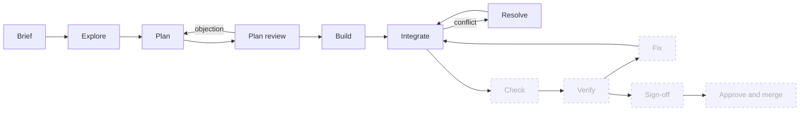
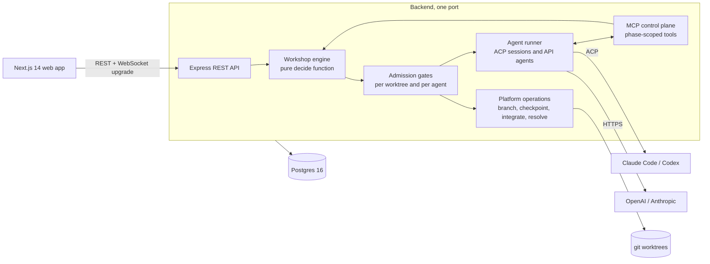

<div align="center">

# Loxo

**A multi-agent coding orchestrator.**

Loxo drives Claude Code and Codex over ACP as one engineering team. Members explore on their own, agree on a reviewed plan, build work packages in parallel git worktrees, and hand their branches to the platform, which integrates them. Every step is recorded in Postgres, and a run survives its backend being killed partway through.

[](https://github.com/jeremychenczm/loxo/actions/workflows/ci.yml)


[How it works](#how-it-works) · [Quick start](#quick-start) · [Crash safety](#crash-safety) · [Architecture](#architecture) · [Testing](#testing) · [Roadmap](#roadmap)

</div>

---

## Why Loxo

One coding agent in one session hits the same limits a single engineer does: its first idea anchors everything after it, it works on one thing at a time, and it grades its own work. Opening several sessions on one repository doesn't make them a team. They step on each other's files, and nobody checks what they claim.

Loxo runs several agents as a team. A multi-agent setup only beats a single agent in three places, and Loxo is built around them:

- **Independent exploration.** Members study the task without seeing each other's notes, so the first answer doesn't steer the rest.
- **Parallel work packages.** The plan splits the work into packages that each owner builds on its own branch in its own worktree, at the same time as the others.
- **Adversarial review backed by evidence.** Members review code they didn't write, and the platform collects the evidence itself instead of trusting an agent's summary. Platform-run checks and cross-review are on the [roadmap](#roadmap).

The platform owns the structure: phases, concurrency, permissions, merges, and checks. Agents fill in the content: plans, code, and reviews. A person always makes the final merge decision.

## How it works

A task runs as a **workshop**: a crew of agents, one of them the lead, taken through a fixed sequence of phases by the workshop engine. Each phase dispatches work to members, waits for a structured report through a phase-specific MCP tool, and advances only on what the platform has recorded.



| Phase | Who | What happens | Status |
|---|---|---|---|
| **Brief** | Platform | Freezes the task snapshot, roster, and base commit; creates an integration worktree and one worktree per member | Shipped |
| **Explore** | Every member, at once | Read-only exploration, blind to the other members; open questions are merged into one request for a person | Shipped |
| **Plan** | Lead | Splits the work into 1–8 packages, each with an owner, the area it owns, dependencies, and acceptance criteria | Shipped |
| **Plan review** | Other members, at once | Approve or object; one revision round, then a person decides | Shipped |
| **Build** | Package owners | Different owners build in parallel; one owner builds their packages in plan order | Shipped |
| **Integrate / Resolve** | Platform, then the owner | Merges packages into the integration branch in dependency order; the owner resolves any conflict on their own branch | Shipped |
| **Check** | Platform | Runs the repository's checks against the integrated candidate | Planned |
| **Verify / Fix** | Members review code they didn't write | Findings go to triage; accepted ones become fix packages | Planned |
| **Sign-off → Merge** | All members, then a person | Every member signs the same commit; a person approves it and the platform merges it into the base branch | Planned |

A **Solo** playbook runs the same engine with one member and a single package.

### What the engine does today

- **Blind exploration.** Members explore at the same time in read-only worktrees. Their peers' notes appear nowhere a member can read: not in the prompt, not in `get_task`, and not on the timeline. If a read-only run edits a tracked file anyway, the platform discards its report and resets the worktree to its state before the run.
- **Validated plans.** `submit_plan` rejects a plan whose owner isn't an active member, whose package keys repeat, or whose dependencies form a cycle, and it lists every reason at once so the lead can fix the plan in the same turn. If the lead never produces a valid plan, the engine falls back to a single package owned by the lead. The accepted plan is pinned by hash and written out as work packages.
- **Parallel builds on package branches.** Each package gets a branch `loxo/t<n>/p/<key>` checked out in its owner's worktree. A package that depends on another starts from the integration commit that already contains its dependency. When an agent reports done, the platform commits the changes, authored as `<member> via Loxo`.
- **Conflict-aware integration.** Before every merge the platform does a dry run with `git merge-tree`. A clean package is merged into the integration branch with `--no-ff`. When a package conflicts, the integration branch isn't touched. The platform merges the integration head into the package branch with the conflict markers left in place and sends it back to the owner. Their report is refused while any marker remains. The platform then commits an explicit two-parent merge with `commit-tree` and integrates the package again. Commits on the integration branch are never rewritten, and the chaos checker verifies that.
- **Never done by silence.** A member who doesn't report is asked once more. After that, a person chooses between retry, skip, and stop. A workshop never stops quietly: every pause is an open human request.

## Quick start

**Prerequisites:** Node.js 20+, Docker, and Git (2.38+ for workshops on a repository).

```bash
npm install
docker compose up -d                      # Postgres 16 on host port 5434

cp backend/.env.example backend/.env      # PowerShell: Copy-Item backend/.env.example backend/.env
cp frontend/.env.example frontend/.env
# Set JWT_SECRET and SECRETS_KEY in backend/.env; the file explains how to generate them.

npm run db:migrate
npm run dev:backend                       # http://localhost:4000
npm run dev:frontend                      # http://localhost:3000, in a second terminal
```

Then open `http://localhost:3000`, register an account, and:

1. Run `npm run runtimes:install` to set up Claude Code and Codex agents, or add an OpenAI or Anthropic provider for API agents.
2. Create agents and register a local git repository.
3. Create a workshop task, then start it:

```http
POST /api/tasks
{ "title": "Add rate limiting", "brief": "...", "repositoryId": "<id>",
  "playbook": "build", "memberAgentIds": ["<lead>", "<peer>"], "leadAgentId": "<lead>" }

POST /api/tasks/<taskId>/start
```

The workshop screens aren't built yet (see the [roadmap](#roadmap)), so a workshop runs through the API for now. Its questions and decisions are human requests: list them with `GET /api/human-requests?taskId=<taskId>&status=open` and answer with `POST /api/human-requests/<id>/answer`.

## Agents and runtimes

Loxo drives the coding CLIs you already have installed, with their existing logins. It talks to them over the [Agent Client Protocol](https://agentclientprotocol.com), and talks to API agents through OpenAI Chat Completions or Anthropic Messages.

| Runtime | Transport | Permissions | Live events |
|---|---|---|---|
| Claude Code | ACP via `@agentclientprotocol/claude-agent-acp` | Every tool call is decided by Loxo's policy | Yes |
| Codex | ACP via `@agentclientprotocol/codex-acp` | Codex's OS sandbox; escalations are decided by Loxo | Yes |
| API agents | Provider API tool loop | Read-only worktree tools | Yes |

- **Platform-decided permissions.** Inside its own worktree an agent may proceed, and outside it the agent is refused. Commands such as `git push`, `sudo`, or recursive deletes outside the worktree go to a person. Questions nobody answers in time are denied. A watchdog stops turns that go silent, stop making progress, or repeat themselves.
- **Run-scoped MCP tools.** Each run reaches Loxo through an MCP server that offers only the tools its phase allows. Every phase gets `get_task` and its report tool (`submit_exploration`, `submit_plan`, `submit_plan_review`, or `submit_result`). Phases that aren't blind also get `comment_on_task` and `ask_blocker`. Calls carry an HMAC-signed run token bound to the run's owner epoch, so a takeover invalidates the old one.

## Crash safety

A backend can die partway through a run, or a second instance can start against the same database. Loxo assumes both happen:

- **Leases and epoch fencing.** Every running run is owned by one backend under a lease on the database clock. Every platform write checks the owner's epoch in the same transaction, so a stale instance can't write after it's been taken over.
- **Recovery by what was committed.** A run that did nothing is retried. A run that submitted its result settles. Anything else waits for a person, with its worktree quarantined.
- **Graceful handoff.** A backend asked to stop, as a deploy does, cancels its agents, captures their work, and lets the next instance resume the same agent sessions.
- **No orphans.** Agents run under a launcher that takes their whole process tree down with the backend.

Measured against real backend processes, killed at named crash points or stopped mid-run (`npm run chaos -w backend`):

<!-- chaos-results:begin source=results/chaos/2026-11-21/summary.json -->
| | Result |
|---|---|
| **Crash matrix** | 153 trials: 12 crash points across 5 run kinds, 3 per cell, the backend process killed outright each time. **0 invariant violations**, 0 errors, 0 unreached |
| **Recovery** | From the crash until every run the dead instance owned was resolved: p50 **4.3 s**, p99 **7.0 s** (4.0 s lease) |
| **Graceful shutdown** | 45 trials across 5 run kinds: the backend asked to stop mid-run, as a deploy does (15), or crashing partway through handing its runs off (30). **0 invariant violations**, 0 errors, 1 unreached; after a clean shutdown 0 runs waited on a person. The instance exits in p50 **0.5 s**, and the work resumes on the next instance p50 **2.1 s**, p99 **2.7 s** after the request |
| **Orphaned agents** | Longest an agent kept working after its backend died: **0 ms** with the launcher; up to **5.0 s** without it, caught in 10 of 10 control trials |
| **Two instances, one database** | 9 races of 50 concurrent wakes, one instance killed, frozen past its lease, or shut down gracefully mid-run: **0 invariant violations** (no run executed twice), 22 takeovers, 1 stale write refused by the fence, up to 10 runs at once |

Commit `0fdfb39`, Windows, Node v24.22.1, 2026-11-21.
<!-- chaos-results:end -->

These numbers come from before the workshop engine existed. The engine already runs in the chaos suite, with its own crash points and invariants (integration only appends, packages merge in dependency order). A full re-measurement with those included is on the [roadmap](#roadmap). The design and the full invariant list are in [docs/durable-runs.md](docs/durable-runs.md).

## Architecture



- **The engine is a pure function.** It takes the workshop's recorded state and returns the next actions: dispatch a member, run a platform operation, open a request, or move to the next phase. It does no I/O itself, so table-driven tests cover every transition. Advancing runs in its own idempotent transaction, and a reconciler picks up any workshop whose advance was cut short by a crash.
- **Agent runs and platform operations share one admission gate.** A worktree holds at most one running actor, whether that's an agent or a git operation by the platform. An agent runs one turn at a time across all tasks. Members of the same task run side by side.
- **Platform operations are redo-safe.** Branching, checkpointing, integrating, and resolving each check git's actual state before acting, so repeating one after a crash produces the same result as doing it once.
- **Postgres 16 + Drizzle ORM** for state, locks, and migration history. Provider keys are encrypted at rest with AES-256-GCM, and the server refuses to start without `JWT_SECRET`.

## Testing

```bash
npm test                          # 600+ backend tests against a real Postgres
npm run test:coverage -w backend  # fails below 90% line coverage of the run-ownership modules
npm run typecheck                 # backend and frontend
```

- **Real git, real processes.** Workshop tests run on throwaway repositories, with scripted ACP agents (`packages/fake-agent`) writing files, colliding on the same lines, stalling, and crashing.
- **One contract for every agent host** (`backend/test/conformance/host-contract.ts`). Every host has to stream a turn, run one turn at a time, cancel promptly, report failures as outcomes, and close cleanly. To run the contract against the real CLIs (this spends model tokens):

  ```bash
  npm run runtimes:install
  LOXO_REAL_CLI=1 npm test -- test/real-cli.test.ts
  ```

- **Chaos suite.** A separate Postgres with commit timestamps enabled, real backend processes, and an invariant checker that reads the database afterward:

  ```bash
  docker compose --profile chaos up -d --wait
  npm run chaos -w backend -- --trials 3 --controls 2 --two 3   # results in results/chaos/<date>/
  ```

CI runs typecheck, the coverage-gated test suite, and a check that every crash-safety number in this README matches the recorded summary it cites.

## Project layout

```
backend/              Express API, workshop engine, platform operations, agent runner
  src/modules/        agents, tasks, workshop, runs, ownership, control-plane, hosts, ...
  scripts/chaos/      crash-point driver, invariant checker, results renderer
frontend/             Next.js 14 app (App Router, Tailwind, Zustand)
packages/shared/      Runtime types, permission levels, process-tree helpers
packages/fake-agent/  Scripted ACP agent used by the test suite
docs/                 Design notes (durable runs)
results/chaos/        Recorded chaos runs that the README numbers come from
```

## Roadmap

- [x] Durable runs: leases, fencing, recovery, graceful handoff, orphan-free launcher
- [x] Workshop engine: Brief, blind Explore, Plan with validation and review
- [x] Parallel builds on package branches, ordered integration, owner-side conflict resolution
- [ ] Blocked packages, reassignment, and skipped members
- [ ] Platform-run checks on an integrated candidate
- [ ] Cross-review, triage, and fix loops
- [ ] Sign-off on one commit, human approval, merge into the base branch
- [ ] Workshop screens in the web app
- [ ] Re-measured chaos results with workshop crash points
- [ ] Local mode: one command with embedded Postgres, plus desktop builds
- [ ] Delivery as a GitHub pull request

The original single-agent board flow (a lead builds, the other members review) still runs alongside the engine. Once Solo covers it, it will be removed.
