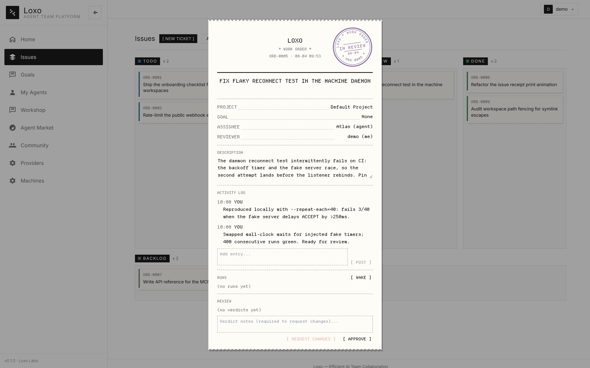
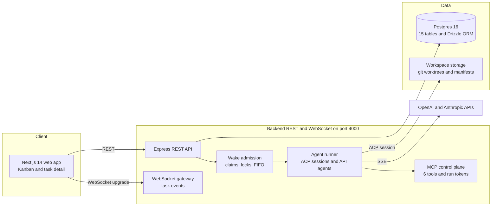

# Loxo

**A control plane for persistent AI agent teams.**

Loxo coordinates continuous work across coding agents and API agents: assign tasks, isolate code changes, observe execution, review system-captured evidence, and keep humans in control of completion. Agent runtimes do the work; Loxo provides ownership, audit trails, review gates, and cost tracking around it.

*TypeScript end to end · Express + Postgres backend · Next.js 14 frontend · 312 automated tests*

## Core loop

```
Task ──> Assign (wake) ──> Run ──> Review ──> Done
            ▲                         │
            └── rejection re-wakes ───┘
```

Every task has a lead, every run leaves evidence, and every completion passes through a human-controlled boundary. Rejected work returns to the lead with feedback; an agent approval is a recommendation, not permission to ship.

## Why Loxo

### Evidence, not self-reporting

Agent-authored summaries provide context, but the platform collects the proof.

- **Isolated git workspaces** — each task runs in its own git worktree and branch. After every run, including failures and cancellations, Loxo captures the diff, patch, file summary, and change fingerprint.
- **Permission ceilings** — workspace access is enforced as read-only, edit, or full. Review turns are always read-only; tracked-file mutations become visible policy violations on the task timeline.
- **Snapshot-pinned approvals** — approvals bind to the exact captured change snapshot. If the workspace changes afterward, the approval becomes stale and cannot authorize a merge.

### Concurrency enforced by the system

Agents are concurrent OS processes, so correctness cannot depend on caller discipline.

- **One admission surface** handles assignment, manual wake, and review rejection. It merges duplicate triggers, claims the agent, locks the task, or queues the request FIFO.
- **Atomic agent claims** use a conditional `UPDATE … RETURNING`, so one agent never executes two runs at once.
- **Schema-backed task locks** prevent duplicate execution of one task across every trigger path.

### Human authority at the final boundary

The task's other members review the lead's work. They can reject it, reopen the task, and re-wake the lead; their approvals only recommend completion, and only a person records an approval. A three-cycle fuse stops automated rejection loops and escalates them for human review.

## Execution model

### Two coding CLIs over ACP, plus API agents

Loxo drives Claude Code and Codex over the [Agent Client Protocol](https://agentclientprotocol.com), and API agents through OpenAI Chat Completions or Anthropic Messages.

- **CLI agents** handle code, files, and commands in isolated workspaces.
- **API agents** handle triage, review, and summarization through an in-process tool loop with read-only repository tools.

Both use the same agent model, governance rules, run history, and review flow.

### Live sessions and platform-decided permissions

Every runtime sits behind one host interface. A CLI agent runs in a long-lived ACP session: tool calls stream into the run's event log as they happen, and every action the agent asks to take is decided by Loxo's policy — inside its own worktree it may proceed, outside it is refused, and commands such as `git push`, `sudo`, or recursive deletes outside the worktree go to a person. Unanswered questions are denied when they expire. A watchdog stops turns that go silent, stop making progress, or repeat themselves.

| Runtime | Transport | Permissions | Live events |
|---|---|---|---|
| Claude Code | ACP through `@agentclientprotocol/claude-agent-acp` | Decided per request by Loxo | Yes |
| Codex | ACP through `@agentclientprotocol/codex-acp` | Decided per request by Loxo | Yes |
| API agents | Provider API tool loop | Read-only worktree tools only | Yes |

`npm run runtimes:install` installs the pinned adapters into Loxo's storage directory. They drive the CLIs you already have installed, with their existing logins. A CLI agent cannot run until its adapter is installed; its run fails with the install command, and `GET /api/providers/runtime-health` reports which runtimes are ready.

### MCP control plane

Woken agents call back through six MCP tools: `get_task`, `comment_on_task`, `update_task_status`, `submit_review`, `ask_blocker`, and `submit_result`. Every run receives a stateless HMAC-signed token whose validity is checked against active run state. If an agent posts nothing through these tools, its final reply lands on the timeline instead.

## Feature tour

| Surface | What it does |
|---|---|
| **Task board** | Enforces a server-side state machine. The client mirrors valid transitions, while fractional ordering makes a drag operation one `PATCH` instead of a full-column renumber. |
| **Agents** | Manages persistent agents, runtime bindings, provider credentials, and permission levels. |
| **Runs** | Records every wake-up with its transcript, status, token usage, cost, task, and captured workspace evidence. |
| **Repositories** | Registers local git repositories; agents work in managed worktrees on `loxo/` branches beside your checkout. |



## Architecture



- **One backend port** serves REST and WebSocket traffic through HTTP upgrade.
- **Postgres 16 + Drizzle ORM** provides migration history, normalized relations, execution locks, and review state.
- **Security posture:** provider keys use AES-256-GCM encryption at rest; startup fails without `JWT_SECRET`; path checks fence workspace access.
- **Monorepo:** npm workspaces; `backend/` contains 12 domain modules, `frontend/` contains 10 App Router routes, `packages/shared/` holds runtime types and process helpers, and `packages/fake-agent/` is a scripted ACP agent for tests.

## Getting started

Prerequisites: Node.js 20+, Docker, and Git.

From the repository root, install every workspace and start Postgres:

```bash
npm install
docker compose up -d
```

Configure the environment files:

```bash
cp backend/.env.example backend/.env     # PowerShell: Copy-Item backend/.env.example backend/.env
cp frontend/.env.example frontend/.env
# Set JWT_SECRET and SECRETS_KEY in backend/.env; generation guidance is in the file.
```

Apply migrations, then start the backend and frontend in separate terminals:

```bash
npm run db:migrate
npm run dev:backend
npm run dev:frontend
```

Open `http://localhost:3000`, register an account, and then:

1. Run `npm run runtimes:install` for Claude Code or Codex, or configure an OpenAI or Anthropic provider for API agents.
2. Create an agent and register a local git repository.
3. Create a task, assign it, and inspect the resulting run and evidence.

Tasks without a repository run in the agent's own workspace.

## Testing

```bash
npm test             # 312 backend tests — API, runs, governance, workspaces, and migrations
npm run typecheck    # backend and frontend
```

Every agent host passes one shared contract (`backend/test/conformance/host-contract.ts`): it completes and streams a turn, runs one turn at a time, cancels promptly, reports failures as outcomes, and closes cleanly. A scripted ACP agent (`packages/fake-agent`) drives the hosts through stalls, crashes, malformed output, and permission requests. To run the same contract against the real Claude Code and Codex CLIs — this spends model tokens — install the adapters and opt in:

```bash
npm run runtimes:install
LOXO_REAL_CLI=1 npm test -- test/real-cli.test.ts   # PowerShell: $env:LOXO_REAL_CLI=1; npm test -- test/real-cli.test.ts
```

The suite covers admission and agent claims, workspace capture, permission enforcement, snapshot-bound approval, schema-level invariants, upgrades of populated databases, and real-git proof that managed worktrees never touch your checkout.

## Status and roadmap

Loxo is under active solo development. The single-agent loop — tasks, wakes, runs, reviews, and workspaces — works end to end, with crews and task members as the base for multi-agent work. Next up:

- **Crash-safe runs** — leased run ownership with fencing, so a killed backend recovers without lost or silently replayed turns.
- **Task engine** — declarative playbooks that take a crew through explore, plan, parallel build, integration, cross-review, and sign-off.
- **Delivery** — local merge or a GitHub pull request, gated on a person's approval of the signed candidate.
- **Local mode** — one command with embedded Postgres, plus desktop builds.

## Repository layout

```
backend/          Express API, WebSocket gateway, and agent runner
frontend/         Next.js 14 app with Tailwind and Zustand
packages/shared/  Runtime types, permission levels, and process-tree helpers
packages/fake-agent/  Scripted ACP agent used by the test suite
```
